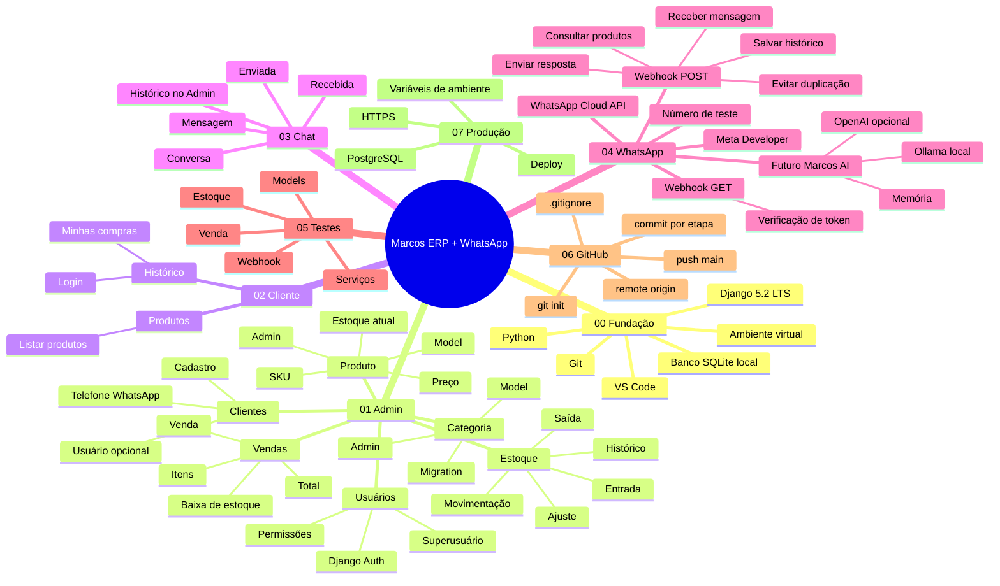
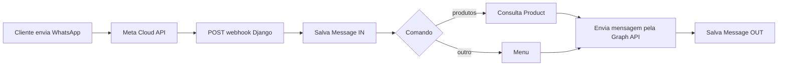

# Marcos ERP + WhatsApp — Mapa mental e sequência de desenvolvimento

> Abra este arquivo no **Obsidian**. O bloco Mermaid abaixo funciona como mapa mental em versões que suportam Mermaid. Depois use a checklist como roteiro de implementação no VS Code.



---

## Regra principal

**Não pule módulos.** Cada etapa usa o que foi criado antes.

## ETAPA 0 — Preparar o computador

- [ ] Instalar Python.
- [ ] Instalar VS Code.
- [ ] Instalar extensão Python no VS Code.
- [ ] Instalar Git.
- [ ] Abrir a pasta do projeto no VS Code.
- [ ] Criar `.venv`.
- [ ] Instalar `requirements.txt`.

Comandos:

```bash
python -m venv .venv
pip install -r requirements.txt
```

No Windows PowerShell, ativação:

```powershell
.venv\Scripts\Activate.ps1
```

---

## ETAPA 1 — Entender a fundação Django

Leia nesta ordem:

1. `manage.py`
2. `config/settings.py`
3. `config/urls.py`

Depois execute:

```bash
python manage.py makemigrations
python manage.py migrate
python manage.py createsuperuser
python manage.py runserver
```

**Objetivo de conclusão:** abrir `/admin/` e entrar com o superusuário.

Commit:

```bash
git add .
git commit -m "chore: configura projeto Django"
```

---

## ETAPA 2 — Categoria e Produto

Arquivos:

- `catalog/models.py`
- `catalog/admin.py`

Conceitos para estudar:

- `models.Model`
- `CharField`
- `DecimalField`
- `ForeignKey`
- `on_delete=models.PROTECT`
- `__str__`
- `ModelAdmin`

Depois:

```bash
python manage.py makemigrations catalog
python manage.py migrate
```

No Admin, crie:

1. uma categoria;
2. dois produtos;
3. preços e SKUs diferentes.

**Objetivo de conclusão:** produtos aparecem no admin e em `/produtos/`.

Commit:

```bash
git add .
git commit -m "feat: adiciona categorias e produtos"
```

---

## ETAPA 3 — Estoque

Arquivos:

- `inventory/models.py`
- `inventory/services.py`
- `inventory/admin.py`

O ponto mais importante é `move_stock()`. Toda entrada/saída programática deve passar por esse serviço para evitar estoque negativo.

Teste no shell:

```bash
python manage.py shell
```

```python
from catalog.models import Product
from inventory.models import StockMovement
from inventory.services import move_stock

p = Product.objects.first()
move_stock(product=p, movement_type=StockMovement.MovementType.IN, quantity=10, note="Estoque inicial")
print(Product.objects.get(pk=p.pk).stock)
```

**Objetivo de conclusão:** registrar entrada e enxergar o histórico no admin.

Commit:

```bash
git add .
git commit -m "feat: implementa controle de estoque"
```

---

## ETAPA 4 — Clientes e Usuários

Arquivos:

- `customers/models.py`
- `customers/admin.py`

O Django já possui `User`. O `Customer` pode ou não estar ligado a um usuário do sistema.

- `Customer.phone`: telefone usado para relacionar WhatsApp e cliente.
- `Customer.user`: permite o cliente fazer login e ver seu histórico.

**Objetivo de conclusão:** cadastrar um cliente e associá-lo a um usuário.

Commit:

```bash
git add .
git commit -m "feat: adiciona clientes e vinculo com usuarios"
```

---

## ETAPA 5 — Vendas

Arquivos:

- `sales/models.py`
- `sales/services.py`
- `sales/admin.py`

Modelagem:

```text
Cliente 1 ---- N Venda 1 ---- N ItemVenda N ---- 1 Produto
```

Use `create_sale()` para criação programática; ele baixa o estoque dentro de uma transação.

Teste no shell:

```python
from customers.models import Customer
from catalog.models import Product
from sales.services import create_sale

cliente = Customer.objects.first()
produto = Product.objects.first()
venda = create_sale(customer=cliente, items=[{"product_id": produto.id, "quantity": 1}])
print(venda.id, venda.total)
```

**Objetivo de conclusão:** venda salva itens e reduz estoque.

Commit:

```bash
git add .
git commit -m "feat: adiciona vendas e baixa de estoque"
```

---

## ETAPA 6 — Módulo Cliente

Arquivos:

- `portal/views.py`
- `portal/urls.py`
- `templates/portal/product_list.html`
- `templates/portal/sale_history.html`

Rotas:

```text
/produtos/    -> lista produtos
/historico/   -> histórico do cliente autenticado
```

**Objetivo de conclusão:** usuário associado a um cliente entra e vê somente as próprias vendas.

Commit:

```bash
git add .
git commit -m "feat: cria portal do cliente"
```

---

## ETAPA 7 — Chat e histórico

Arquivos:

- `chatapp/models.py`
- `chatapp/admin.py`

Estrutura:

```text
Customer (opcional)
      |
Conversation
      |
   Message
```

Cada mensagem salva direção `IN` ou `OUT`.

**Objetivo de conclusão:** abrir uma conversa no Admin e visualizar mensagens inline.

Commit:

```bash
git add .
git commit -m "feat: adiciona historico de chat"
```

---

## ETAPA 8 — Integrar WhatsApp

Arquivos:

- `.env`
- `chatapp/whatsapp.py`
- `chatapp/views.py`
- `chatapp/urls.py`

Webhook local:

```text
GET  /whatsapp/webhook/ -> Meta verifica seu token
POST /whatsapp/webhook/ -> Meta entrega mensagens
```

Fluxo:



Variáveis necessárias no `.env`:

```env
WHATSAPP_VERIFY_TOKEN=escolha-um-token
META_APP_SECRET=segredo-do-app-meta
WHATSAPP_ACCESS_TOKEN=token-da-meta
WHATSAPP_PHONE_NUMBER_ID=id-do-numero
WHATSAPP_GRAPH_VERSION=versao-exibida-no-painel-da-meta
```

Para desenvolvimento, o endpoint precisa ficar publicamente acessível por HTTPS. Não exponha `WHATSAPP_ACCESS_TOKEN`, `META_APP_SECRET` ou qualquer segredo no Git. O código também valida `X-Hub-Signature-256` quando `META_APP_SECRET` está configurado.

**Primeiro comportamento do bot:**

```text
Usuário: produtos
Bot: lista até 10 produtos com preço e estoque
```

**Objetivo de conclusão:** enviar `produtos` no WhatsApp e receber produtos cadastrados no Django.

Commit:

```bash
git add .
git commit -m "feat: integra webhook do WhatsApp"
```

---

## ETAPA 9 — Git/GitHub

Na raiz do projeto:

```bash
git init -b main
git add .
git commit -m "chore: inicia projeto Marcos ERP"
```

Crie um repositório vazio no GitHub, sem README automático. Depois:

```bash
git remote add origin https://github.com/SEU-USUARIO/SEU-REPOSITORIO.git
git remote -v
git push -u origin main
```

Rotina diária:

```bash
git status
git add .
git commit -m "feat: descreva o que voce fez"
git push
```

### Padrão de commits sugerido

- `feat:` funcionalidade nova
- `fix:` correção
- `refactor:` reorganização sem mudar comportamento
- `docs:` documentação
- `test:` testes
- `chore:` configuração/manutenção

---

## ETAPA 10 — Checklist do MVP

### Admin
- [ ] Usuários funcionando.
- [ ] Categorias funcionando.
- [ ] Produtos funcionando.
- [ ] Estoque com entrada/saída/histórico.
- [ ] Clientes funcionando.
- [ ] Vendas funcionando.
- [ ] Chat/histórico funcionando.

### Cliente
- [ ] Lista de produtos.
- [ ] Login.
- [ ] Histórico somente do próprio cliente.

### WhatsApp
- [ ] Meta Developer configurado.
- [ ] Webhook validado.
- [ ] Mensagem recebida.
- [ ] Mensagem salva.
- [ ] `produtos` consulta o banco.
- [ ] Resposta enviada ao WhatsApp.
- [ ] Resposta salva no histórico.

### Git
- [ ] `.env` ignorado.
- [ ] Repositório criado.
- [ ] Commits por etapa.
- [ ] `main` enviada ao GitHub.

---

## ETAPA 11 — Depois do MVP

Só depois de tudo acima funcionando:

1. formulário próprio de vendas com validação completa;
2. permissões por função (admin, vendedor, cliente);
3. PostgreSQL;
4. dashboard de vendas;
5. carrinho/pedido pelo cliente;
6. atendimento humano + WhatsApp;
7. Marcos AI com IA local via Ollama;
8. memória do assistente;
9. tarefas e automações;
10. deploy HTTPS.

## Regra para consultar este mapa

Quando se perder, responda três perguntas:

1. **Em qual ETAPA estou?**
2. **Qual arquivo dessa etapa estou editando?**
3. **Qual é o objetivo de conclusão da etapa?**

Só avance quando o objetivo estiver funcionando.
